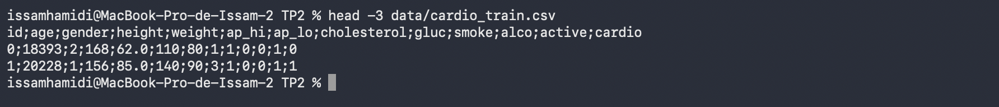
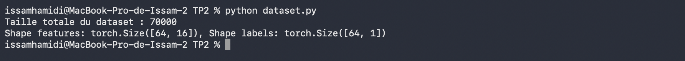
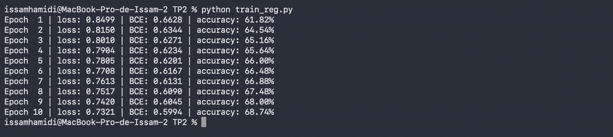
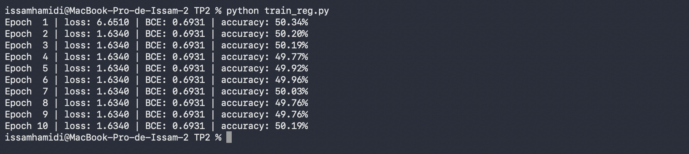
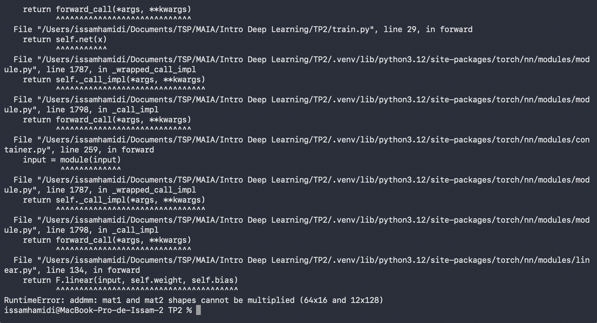
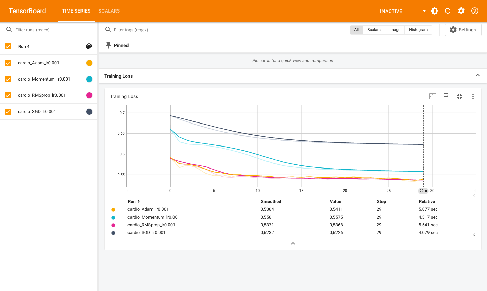
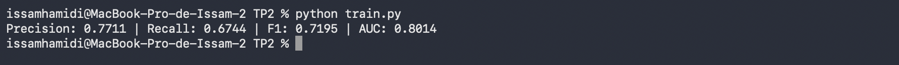

# TP2 — Régularisation, optimisation et métriques

## 1. Création d'un dataset personnalisé

J'ai téléchargé `cardio_train.csv` sur Kaggle et je l'ai mis dans `TP2/data/`. Les colonnes sont séparées par des `;`, d'où le `sep=";"` dans le code.



J'ai ensuite créé [dataset.py](dataset.py) avec le code du sujet et complété les trous :

```python
def __len__(self):
    # Retourne la taille du dataset
    return len(self.labels)

def __getitem__(self, idx):
    ...
    # Récupérer les features et le label à l'index 'idx'
    local_features = self.features[idx]
    local_labels = self.labels[idx]
```

```python
train_loader = DataLoader(train_set, batch_size=64, shuffle=True)
val_loader   = DataLoader(val_set, batch_size=64, shuffle=False)
```

Pour la taille, j'ai pris `self.labels` (il y a un label par patient, donc ça revient au même que `self.features`). Je mélange le train à chaque époque, mais pas la validation car l'ordre n'y change rien.

Exécution de `dataset.py` :



On a bien 70 000 patients. Un batch contient 64 exemples de 16 features : les 8 variables numériques/binaires (age, height, weight, ap_hi, ap_lo, smoke, alco, active) plus 2 colonnes pour gender, 3 pour cholesterol et 3 pour gluc après le one-hot. Les labels sont de taille (64, 1), ce qui correspond à la sortie du MLP avec la BCELoss.

### Question 1 : data leakage

Le StandardScaler calcule la moyenne et l'écart-type sur tout le dataset, donc aussi sur les données de validation et de test. Des infos du test se retrouvent dans le prétraitement des données d'entraînement. Le modèle n'est plus évalué sur des données vraiment "inconnues" et les scores sont un peu trop optimistes. Il faudrait faire le split d'abord, fitter le scaler sur le train uniquement, puis appliquer ce même scaler (`transform`) sur la val et le test.

### Question 2 : dataset trop gros pour la RAM

J'utiliserais `torch.utils.data.IterableDataset`. Au lieu d'accéder aux données par index, on définit `__iter__` qui lit le fichier petit à petit (par exemple par chunks avec pandas) et renvoie les exemples un par un, sans jamais tout charger en mémoire.

---


## 2. MLP et régularisation L1 / L2

J'ai mis cette partie dans [train_reg.py](train_reg.py). Je n'ai pas voulu l'écraser avec la partie 3, donc `train.py` contient la comparaison des optimiseurs.

Les loaders de `dataset.py` sont créés dans le `if __name__ == '__main__'`, je ne peux pas les importer directement. J'importe donc la classe sous le commentaire prévu, et je refais le split avec la même seed :

```python
# (Importez votre CardioDataset et vos loaders ici)
from torch.utils.data import DataLoader, random_split
from dataset import CardioDataset

dataset = CardioDataset("data/cardio_train.csv")
generator = torch.Generator().manual_seed(42)
train_set, val_set, test_set = random_split(dataset, [0.8, 0.1, 0.1], generator=generator)
train_loader = DataLoader(train_set, batch_size=64, shuffle=True)
val_loader = DataLoader(val_set, batch_size=64, shuffle=False)
test_loader = DataLoader(test_set, batch_size=64, shuffle=False)
batch = next(iter(train_loader))
```

Il faut aussi `import torch`, car le code du sujet utilise `torch.device`. Le `batch` du début sert à récupérer le nombre de features pour `input_size`.

Les trous de la boucle d'entraînement :

```python
optimizer.zero_grad()
...
# Calcul de la pénalité L2 (somme des carrés des poids)
l2_penalty = sum(p.pow(2).sum() for p in model.parameters())
...
loss.backward()
optimizer.step()
```

Le code du sujet n'affiche rien pendant l'entraînement. Pour voir la loss et la précision demandées dans la question, j'ai ajouté à la fin de chaque époque un affichage de la loss totale, de la BCE seule et de l'accuracy sur le train :

```python
        total_loss += loss.item()
        total_bce += base_loss.item()
        correct += ((outputs > 0.5).float() == targets).sum().item()
        total += targets.size(0)

    print(f"Epoch {epoch+1:2d} | loss: {total_loss/len(train_loader):.4f} | BCE: {total_bce/len(train_loader):.4f} | accuracy: {100*correct/total:.2f}%")
```

Premier essai avec les valeurs du sujet (l1 = 1e-4, l2 = 1e-3) :



Le modèle apprend : la BCE passe de 0.663 à 0.599 et l'accuracy monte jusqu'à 68.7 % en 10 époques.

### Question 1 : l1_lambda = 0.1 et l2_lambda = 0

J'ai changé les deux valeurs dans le script puis je l'ai relancé :

```python
l1_lambda = 0.1
l2_lambda = 0
```



Cette fois le modèle n'apprend rien du tout. La BCE reste bloquée à 0.6931, ce qui vaut ln(2) : le réseau sort 0.5 pour tous les patients. L'accuracy reste autour de 50 %, comme un tirage au hasard puisque les deux classes sont à peu près équilibrées.

À la première époque, la loss totale vaut 6.65 alors que la BCE ne vaut que 0.69. La pénalité écrase donc complètement le terme utile, et l'optimiseur ne fait plus que réduire les poids. Ils sont tous poussés vers 0, et le réseau devient trop simple pour représenter quoi que ce soit. C'est du sous-apprentissage (underfitting). La loss totale ne tombe pas à 0 et reste à 1.634, parce qu'avec SGD les poids oscillent autour de 0 sans jamais s'y fixer exactement.

Après ce test, j'ai remis les valeurs du sujet dans le fichier.

### Question 2 : L2 dans l'optimiseur

C'est l'argument `weight_decay` de l'optimiseur, par exemple :

```python
optimizer = optim.SGD(model.parameters(), lr=0.01, weight_decay=1e-3)
```

### Question 3 : différence entre L1 et L2

L1 pousse beaucoup de poids à être exactement nuls. On obtient un modèle parcimonieux, un peu comme si on faisait de la sélection de features. L2 pénalise surtout les gros poids : il les réduit tous petit à petit, mais ils deviennent rarement exactement 0.

---

## 3. Comparaison des optimiseurs et TensorBoard

Dans [train.py](train.py), j'ai repris les imports, les loaders et la classe `MLP` de la partie 2, puis j'ai ajouté la fonction `train_model` du sujet. Pour les trous, j'ai utilisé les deux optimiseurs de `torch.optim` :

```python
elif opt_name == "RMSprop":
    optimizer = optim.RMSprop(model.parameters(), lr=learning_rate)
elif opt_name == "Adam":
    optimizer = optim.Adam(model.parameters(), lr=learning_rate)
```

Au premier lancement, le script a planté :



Le sujet crée le modèle avec `input_size=12`, mais on a vu dans la partie 1 qu'il y a 16 features après le one-hot encoding. La première couche attend donc 12 valeurs alors qu'elle en reçoit 16. C'est la seule ligne du sujet que j'ai modifiée :

```python
model = MLP(input_size=16, hidden_size=128).to(device)
```

Ensuite, j'ai lancé `python train.py` puis TensorBoard :


### Question 1 : courbes des 4 optimiseurs



| Optimiseur | Loss époque 1 | Loss époque 30 |
|---|---|---|
| SGD | 0.693 | 0.623 |
| Momentum | 0.661 | 0.558 |
| RMSprop | 0.589 | 0.537 |
| Adam | 0.592 | 0.541 |

### Question 2 : convergence initiale

RMSprop et Adam convergent le plus vite, quasiment à égalité. Dès la première époque ils sont autour de 0.59, alors que SGD est encore à 0.69. Les deux courbes restent ensuite presque collées jusqu'à la fin. Ces deux méthodes adaptent le pas pour chaque paramètre, ce qui aide beaucoup avec un petit learning rate comme 0.001.

### Question 3 : SGD vs Momentum

SGD seul descend très lentement : après 30 époques il est encore à 0.623. Momentum atteint ce niveau dès l'époque 4. Le moment garde en mémoire une moyenne des gradients précédents. Quand les gradients vont dans la même direction, les pas s'accumulent et la descente accélère (avec β = 0.9, le pas effectif est environ 10 fois plus grand). Ça lisse aussi les oscillations dues au bruit des mini-batchs.

---

## 4. Analyse des métriques

J'ai ajouté la fonction `evaluate_model` à la fin de [train.py](train.py). Les trous :

```python
with torch.no_grad(): # Désactiver le calcul des gradients
...
precision = precision_score(all_targets, all_preds_classes)
recall = recall_score(all_targets, all_preds_classes)
```

La précision et le rappel se calculent sur les classes prédites (après le seuil à 0.5). Seule l'AUC utilise directement les probabilités.

Le sujet demande d'évaluer le meilleur modèle, mais `train_model` ne renvoie rien. Pour ne pas modifier la boucle du sujet, je garde chaque modèle entraîné dans un dictionnaire, en ajoutant une ligne à la fin de `train_model` :

```python
trained_models = {}
...
    writer.close()
    trained_models[opt_name] = model
```

J'ai pris Adam comme meilleur modèle. RMSprop finit très légèrement plus bas, mais l'écart est minime (0.537 contre 0.541) et Adam est l'optimiseur qu'on utilise le plus souvent par défaut. Je l'évalue sur le jeu de test à la toute fin du script :

```python
evaluate_model(trained_models["Adam"], test_loader)
```



| Precision | Recall | F1 | AUC |
|---|---|---|---|
| 0.771 | 0.674 | 0.720 | 0.801 |

### Question 1 : définitions

La précision, c'est la part de vrais malades parmi les patients que le modèle prédit malades : TP / (TP + FP).
Le rappel, c'est la part des vrais malades que le modèle arrive à détecter : TP / (TP + FN).

### Question 2 : précision ou rappel en médecine ?

Il vaut mieux privilégier le rappel. Un faux négatif, c'est un malade qu'on renvoie chez lui sans traitement, ce qui peut être grave. Un faux positif coûte seulement des examens en plus. Notre modèle a un rappel de 0.67 : il rate environ un tiers des malades, ce qui est trop pour un usage médical. On pourrait baisser le seuil sous 0.5 pour en détecter plus, quitte à perdre un peu en précision.

### Question 3 : intérêt de l'AUC

La précision, le rappel et le F1 dépendent du seuil choisi (0.5 ici). L'AUC prend en compte tous les seuils possibles. Elle mesure la capacité du modèle à donner un score plus élevé à un malade qu'à un non-malade, quel que soit le seuil. Avec 0.80, le modèle sépare plutôt bien les deux classes. On peut donc comparer des modèles avec l'AUC, puis choisir le seuil selon ce qu'on veut privilégier (ici le rappel).
